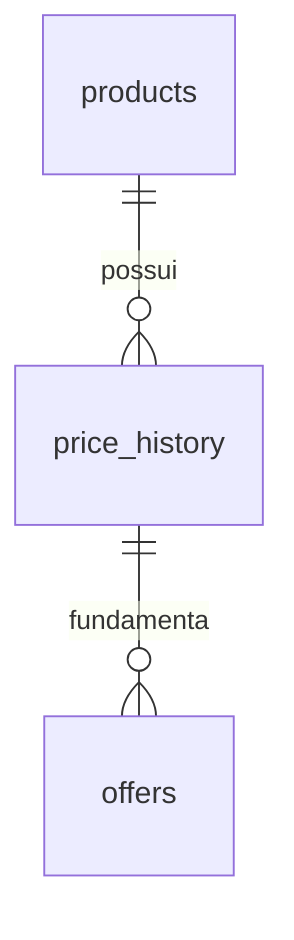

# Banco de dados — etapa 2

## Relações



`products` identifica um anúncio pelo par `item_id` + `variation_id`.
Sem variante conhecida, usar a string vazia, nunca NULL. Ao descobrir variantes,
a coleta futura deve manter a identidade correta, sem misturar preço de uma
variante com preço genérico. A moeda nesta fase é exclusivamente BRL.

`price_history` registra `product_id`, `price_cents` e `observed_at`.
O preço observado não é o preço promocional "de" informado pelo vendedor.
Uma observação deve ser acrescentada, não substituída, pelos futuros serviços.
Esta etapa ainda não implementa serviço de ingestão nem bloqueio de UPDATE;
não altera preços existentes por conta própria.

`offers` guarda título e imagem próprios, link de afiliado opcional e uma
referência ao preço observado. Isso evita duplicar um valor monetário que
poderia divergir da observação. O título/imagem da oferta não mudam quando
o cadastro do produto é atualizado. O preço fica acessível por
`offer.price_history.price_cents` e a moeda por `offer.price_history.product.currency`.

Uma chave estrangeira composta exige que `product_id` e `price_history_id`
correspondam à mesma observação. Exclusões de produtos com histórico e de
observações usadas por ofertas são rejeitadas, sem cascata destrutiva.

## Valores e datas

- R$ 199,90 é armazenado como `19990` em uma coluna BIGINT.
- O ORM exige um inteiro positivo, rejeita float/bool/string e valores acima
  do limite de BIGINT. O banco também impõe preço positivo.
- A conversão de valores da API para centavos será implementada no serviço de
  ingestão usando Decimal; não usar `int(preco_float * 100)`.
- Datas Python devem incluir fuso. O tipo `UTCDateTime` converte para UTC,
  armazena sem fuso e retorna objetos com fuso UTC, inclusive no SQLite.
- Defaults de datas são gerados em Python; SQL direto deve fornecer timestamps
  UTC explicitamente. Isso evita depender do fuso da sessão do PostgreSQL.

## Status

O padrão é `pending`. O banco aceita somente `pending`, `approved`, `published`
e `rejected`; os mesmos valores são expostos no enum `OfferStatus`.
As regras de transição, a exigência de link válido para aprovação e o estado
individual por canal serão adicionados nos serviços de aprovação/publicação.
Persistir um status nesta etapa não dispara publicação e não valida essas regras.

## Migrações

Executar a partir de `afiliados-ml/`, usando a configuração DATABASE_URL já existente:

```powershell
.\.venv\Scripts\python.exe -m alembic upgrade head
.\.venv\Scripts\python.exe -m alembic current
.\.venv\Scripts\python.exe -m alembic check
```

`upgrade head` aplica somente revisões pendentes. Não usar `Base.metadata.create_all`
para evoluir bancos existentes. A migração `9ba84470960b` é independente dos modelos
Python atuais, para que mudanças futuras não alterem revisões antigas.

Para uma mudança de esquema futura, na respectiva feature:

```powershell
.\.venv\Scripts\python.exe -m alembic revision --autogenerate -m "describe schema change"
```

Revisar o arquivo gerado antes de aplicar, especialmente constraints e perdas
de dados. Fazer backup antes de migrações em bancos com dados importantes.
`alembic downgrade base` remove as três tabelas e seus dados: usar apenas em
banco descartável. O teste de reversão usa banco temporário isolado.

## Verificação e limites

24 testes passaram em SQLite com Python 3.13.3, incluindo o esquema criado por
Alembic, consistência entre metadata e migração, persistência após novo upgrade,
rollback, integridade referencial e normalização de fuso.
As APIs SQLAlchemy e o esquema foram mantidos portáveis; PostgreSQL ainda
precisa de driver e testes reais de integração. Não há chamadas externas nesta etapa.

Referências: [Alembic](https://alembic.sqlalchemy.org/en/latest/tutorial.html),
[tipos SQLAlchemy](https://docs.sqlalchemy.org/en/20/core/type_basics.html).

## Git da etapa 2

Na raiz do repositório (pasta pai de `afiliados-ml/`):

```powershell
git fetch origin
git switch -c feature/product-models origin/main
git add afiliados-ml/app/models.py afiliados-ml/alembic.ini afiliados-ml/migrations afiliados-ml/requirements.txt afiliados-ml/requirements.lock.txt afiliados-ml/tests/test_models.py
git commit -m "feat: persist products price history and offer statuses" -m "Separate listing variants, store prices as integer cents and normalize timestamps to UTC. Enforce offer-to-history identity and restrict destructive deletes. Add Alembic migrations and persistence tests. Validation: 24 tests passed; pip check passed; migration upgrade, current and check verified locally."
git add afiliados-ml/README.md afiliados-ml/docs
git commit -m "docs: explain product schema and migration workflow" -m "Document cent-based prices, UTC dates, status boundaries and migration commands. Update setup, endpoint inventory and roadmap for step 2. Validation: git diff --check."
git push -u origin feature/product-models
```

Os comandos registram o fluxo da etapa; não repetir criação de branch/commits
se já existem. O merge será feito no PR somente após aprovação explícita, com
merge commit para preservar os commits pequenos. Não executar merge local
nem enviar alterações diretamente para `main`.
